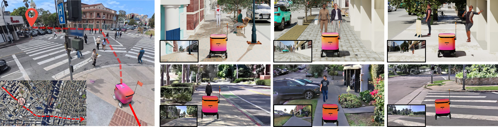
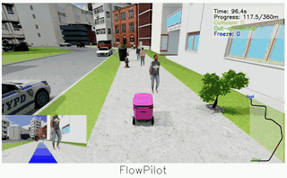
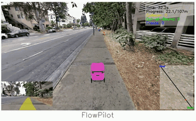
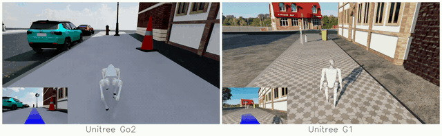

# SidewalkBench: Benchmarking Visual Navigation on Urban Sidewalks

<a href="https://arxiv.org/abs/2606.16953"></a> 
<a href="https://vail.cs.ucla.edu/SidewalkBench/"></a>


[Zhizheng Liu](https://bosmallear.github.io/)<sup>1,\*</sup>, [Honglin He](https://dhlinv.github.io/)<sup>1,\*</sup>, [Vivek Alumootil](https://www.linkedin.com/in/vivekalumootil/)<sup>1,\*</sup>, <br>[Akshat Pandya](https://www.linkedin.com/in/akshat-pandya/)<sup>2</sup>, [Brad Squicciarini](https://www.linkedin.com/in/brad-squicciarini-478954126/)<sup>2</sup>, [Wayne Wu](https://wywu.github.io/)<sup>1</sup>, [Bolei Zhou](https://boleizhou.github.io/)<sup>1</sup>

<sup>1</sup> University of California, Los Angeles &nbsp;&nbsp;&nbsp;&nbsp; <sup>2</sup> Coco Robotics &nbsp;&nbsp;&nbsp;&nbsp; <sup>\*</sup> Equal Contribution


 

## Installation

See [Install.md](/INSTALL.md)


## Quick Start
### Procedurally Generated Scenes

 

To reproduce the results, use the entry points `sidewalkbench/pg/envs/eval_short.py` (unit-test and
pedestrian-reactive scenarios) and `sidewalkbench/pg/envs/eval_long.py` (long-horizon scenarios).

unit-test scenarios in `configs/unit_test` and pedestrian-reactive scenarios in
`configs/pedestrian_reactive`:
```shell
uv run sidewalkbench/pg/envs/eval_short.py --num_envs 10    --config configs/pedestrian_reactive/gesturing/FlowPilot.yaml  --robot_type coco    --use_fixed_texture  --max_resets 10
```

long-horizon scenarios in `configs/long_horizon`:
```shell
uv run sidewalkbench/pg/envs/eval_long.py   --num_envs 10      --config configs/long_horizon/FlowPilot.yaml  --robot_type coco    --use_fixed_texture  --max_resets 10
```


| Flag | Purpose and default |
| --- | --- |
| `--seed` | Seed for procedural scene generation and environment resets. CLI default: `42`. The benchmark uses `42` for long-horizon scenarios and seeds `42–46` for the five-run short-horizon averages. |
| `--texture_seed` | Seed for the texture/sky pools and their resampling per short-horizon round or long-horizon row when `--use_fixed_texture` is omitted. Default: `21`. |
| `--use_fixed_texture` | Uses fixed materials and  lightings. Enabled in the benchmark commands above. |
| `--num_obstacles N` | Overrides the static obstacle count. Default: **36** |
| `--sidewalk_width WIDTH` | Sidewalk width in meters. Default: **4.0** |

### Real-World Scanned Scenes



To run the unit-test real-world scenarios:
```shell
sidewalkbench/gs/run_all.sh --num_envs 4 --mode short_horizon --exp_name gs_sh
```
To run the long-horizon real-world scenarios:
```shell
sidewalkbench/gs/run_all.sh --num_envs 4 --mode long_horizon --exp_name gs_lh
```
`--models FlowPilot` / `--scenes dark` select a subset, `--seed` (default `42`) selects the seed.

## Visualization

Both evaluation scripts support visualization with **`--num_envs 1`**.

| Flag | Output |
| --- | --- |
| `--online_viewer` | Live visualization window. On a server without a display, omit `--online_viewer` to save recordings. |
| `--save_images` | JPEGs of the camera observation, full panel layout, and demo view. |
| `--save_video` | MP4 recordings of the third-person view with a trajectory inset. |
| `--save_mcap` | Foxglove MCAP recordings containing image panels, predicted waypoints, velocity commands, and robot poses. |


Use a new `--exp_name` when recording a fresh run: evaluation skips a run if its
experiment directory already contains `results.pkl`.

The scanned scenes only support `--save_images` and `--save_video`, and don't require only one environment.

## Embodiments



`--robot_type` selects the robot (default `coco`, the Ackermann-steered delivery robot). Every robot takes the
same `(v, w)` command from the model's controller:

- `coco`: wheel-velocity and steering targets (`sidewalkbench/pg/primitives/robot/coco.py`).
- `go2`: a learned velocity-tracking policy at 50 Hz (`sidewalkbench/pg/primitives/robot/legged.py`,
  policy `assets/robots/Go2/policy_flat.pt`).
- `g1`: a learned velocity-tracking policy at 50 Hz (`sidewalkbench/pg/primitives/robot/legged.py`,
  policy `assets/robots/G1/policy_flat.pt`).
- `m20`: fixed leg stance, skid-steered wheels (`sidewalkbench/pg/primitives/robot/legged.py`).

`--kinematics_only` keeps the rigid-body versions of coco/go2/m20. Results of non-default robots are written to
`<exp_folder>_<robot_type>`.


```
uv run sidewalkbench/pg/envs/eval_short.py --num_envs 10 --config configs/unit_test/straight/FlowPilot.yaml --robot_type go2 --max_resets 10
```

## Goal Conditioning

Goal-conditioned evaluation is opt-in via `use_goal: true` for models that declare `BaseModel.goal_type`:

- `"point"` models (CityWalker, MBRA, S2E) receive a robot-frame goal point `[x_fwd, y_left]` [m].
- `"image"` models (NoMaD, ViNT) receive an egocentric goal image captured by a dedicated free goal camera.

Scenario configs omit `use_goal` to use the default goal-less evaluation.
Set `use_goal: true` to opt into goal conditioning. FlowPilot and Cosmos3 use goal-less inference.

In `eval_short.py` the goal is the scenario endpoint. In `eval_long.py` the route is split into
`goal_segment_length` [m] segments (default 30) and the goal advances once the robot is within
`goal_advance_margin` [m] (default 1) of the current segment goal; both keys can be overridden per config.

In goal-less evaluation, CityWalker, MBRA, and S2E sample the same synthetic
goal distribution: forward 2–10 m and lateral −2 to 2 m. ViNT and NoMaD receive a random noisy image.
Each environment's goal is resampled on every inference call. 

## Controller

All tested trajectory models use the shared PD controller in
`sidewalkbench/models/pd_controller.py`. Its defaults are:

- Speed targets the waypoint nearest half the prediction horizon.  
- Steering targets the final waypoint.
- Both commands use half the prediction horizon as their time divisor.
- Forward speed is limited to 0--1.5 m/s; angular velocity is limited to
  +/-0.65 rad/s. Velocity smoothing remains enabled.

An additional pure pursuit controller has been also implemented in `sidewalkbench/models/pure_pursuit.py`.


## Custom Model

Subclass `BaseModel` in `sidewalkbench/models/base_model.py` and implement `inference_trajectory`; the base class provides the shared PD interface. See `sidewalkbench/models/MBRA/inference.py`, then register the model in `sidewalkbench/pg/inference_scripts/get_model.py` and add scenario configs.

## Acknowledgements
We would like to thank the following projects for inspiring our work and open-sourcing their implementations:


Urban Simulation: [MetaUrban](https://github.com/metadriverse/metaurban), [Urban-Sim](https://github.com/metadriverse/urban-sim), [UrbanVerse](https://github.com/VAIL-UCLA/UrbanVerse)

Pedestrian Motion: [MotionLCM](https://github.com/Dai-Wenxun/MotionLCM), [PedGen](https://github.com/genforce/PedGen), [Motion-X](https://github.com/IDEA-Research/Motion-X)

Pedestrian Animation: [NeuMan](https://github.com/apple-aiml-research/ml-neuman), [SMPLitex](https://github.com/dancasas/SMPLitex), [HUGS](https://github.com/apple-aiml-research/ml-hugs)

Simulation Infrastructure: [Isaac Sim](https://github.com/isaac-sim/IsaacSim/tree/main), [Isaac Lab](https://github.com/isaac-sim/IsaacLab), [Nvdiffrast](https://github.com/NVlabs/nvdiffrast)

Visual Navigation Models: [ViNT, NoMaD](https://github.com/robodhruv/visualnav-transformer), [MBRA](https://github.com/NHirose/Learning-to-Drive-Anywhere-with-MBRA), [CityWalker](https://github.com/ai4ce/CityWalker), [InternNav](https://github.com/InternRobotics/InternNav), [Cosmos3](https://github.com/NVIDIA/cosmos), [MIMIC](https://github.com/VAIL-UCLA/MIMIC), [S2E](https://github.com/VAIL-UCLA/S2E), [FlowPilot](https://github.com/VAIL-UCLA/FlowPilot)

## Contact

For any questions or discussions, please contact [Zhizheng Liu](zhizheng@cs.ucla.edu).
Feel free to submit a pull request or an issue to help make our benchmark better!

## Reference

If our work is helpful to your research, please cite the following:

```bibtex
@inproceedings{liu2026sidewalkbench,
    title     = {{SidewalkBench}: Benchmarking Visual Navigation on Urban Sidewalks},
    author    = {Liu, Zhizheng and He, Honglin and Alumootil, Vivek and Pandya, Akshat and Squicciarini, Brad and Wu, Wayne and Zhou, Bolei},
    booktitle = {Conference on Robot Learning},
    year      = {2026},
  }

```
